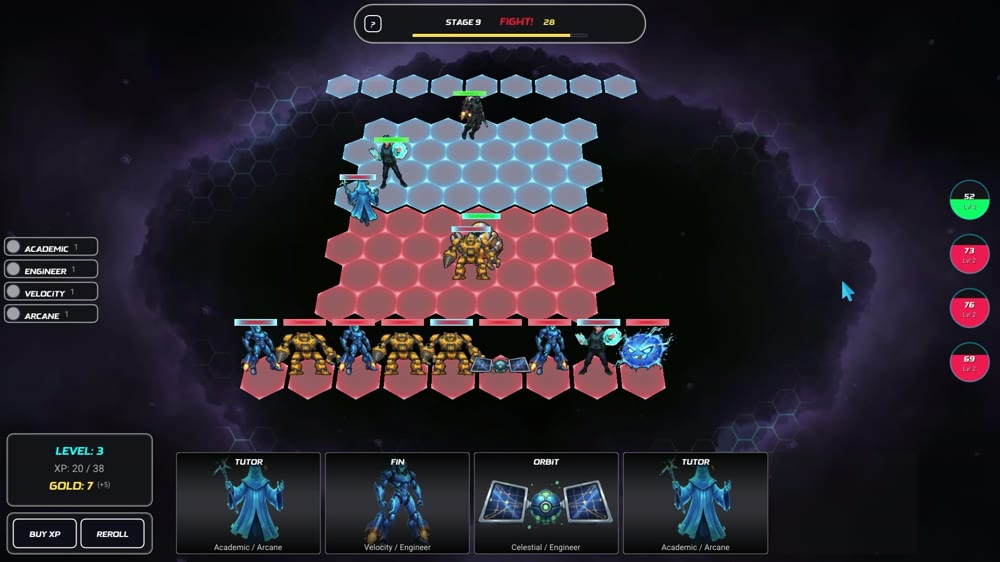
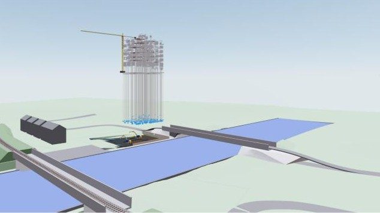
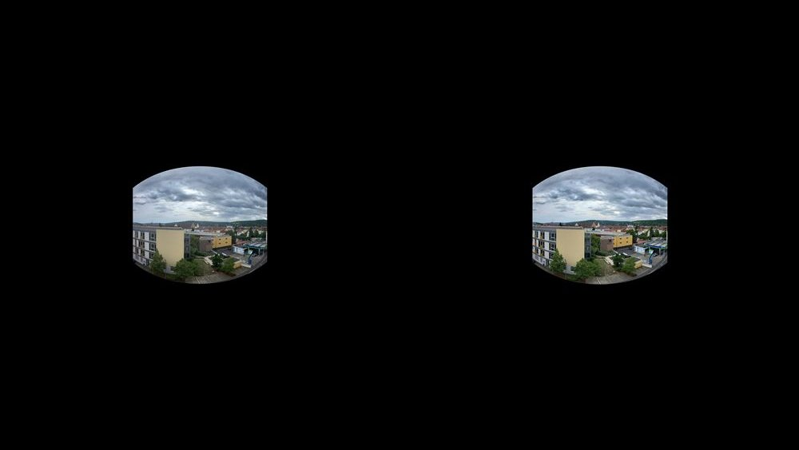
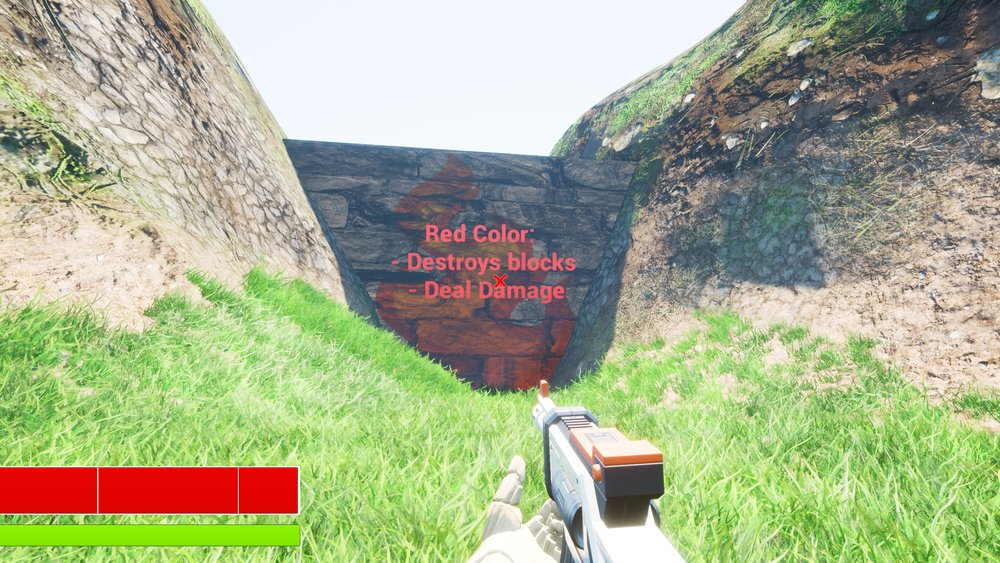

## About me

Software developer from Würzburg, B.Sc. in Games Engineering (University of Würzburg, 2026). Since 2022 I've built software for large construction projects at [Building Information Innovator](https://bii-gmbh.com/).

Since April 2026 I have worked agent-first: I define what gets built, direct AI coding agents, review what they produce and own what ships. Before that I wrote React, TypeScript, Dart and C# by hand for years.

## Experience

**[Building Information Innovator](https://bii-gmbh.com/)**, Würzburg · Software Developer, full time since April 2026, working student 2022 to 2026

- **[simbox](https://simbox.site)** (2026 to today): AI-native 4D simulation platform. Rendering, geodata, multi-user sessions, AI agent and MCP server.
- **Internal tools** (2026 to today): time tracking and leave system, AI tooling.
- **Semmering Base Tunnel** (2024 to 2026): frontend of the digital control room. React, TypeScript.
- **dProB web viewer** (2023 to 2025): browser viewer for 4D construction simulations. React, three.js.
- **[Koralm Tunnel](https://www.bii-gmbh.com/en/references/koralm-tunnel/)** (2022 to 2024): frontend of the construction management platform. React, TypeScript.

**[TOUGH Training](https://tough-training.com/)**, internship 2022 · 3D safety training for the construction industry. Unity, C#.

## Tech stack

**Hand-written for years** 

**Agent-driven since 2026** 
 
Plus WGSL shaders, CI and deployment, Claude Code and MCP.

**Earlier projects** 

## Projects

<table>
<tr>
<td width="50%" valign="top">

### 🎯 DartArena

Cross-platform darts companion with ranked mode, online matches and career stats. My most complete Flutter project. **[Web app](https://dartarena.web.app)**

</td>
<td width="50%" valign="top">

### 🏅 [MiniOlympiade](https://github.com/PhoenixFlyy/MiniOlympiade)

Flutter app that runs a team tournament for friends, with live scores and standings.

</td>
</tr>
<tr>
<td width="50%" valign="top">

### ⛏️ [Firmament Ages](https://github.com/PhoenixFlyy/firmament-ages)

Co-op Minecraft modpack on [CurseForge](https://www.curseforge.com/minecraft/modpacks/firmament-ages), with my own Java mod and Python build tooling.

</td>
<td width="50%" valign="top">

### 📱 Bingable

Flutter app for learning languages with the series you watch. I built the app; two friends handled data and design.

</td>
</tr>
</table>

## University

<table>
<tr>
<td width="50%" valign="top">

### ⚔️ Voidforge Arena

GameLab 3. 2.5D auto-battler on my own C++ engine with OpenGL and an entity component system.

</td>
<td width="50%" valign="top">

### 🎓 Bridging from 2D Diagrams to 4D Scenes

Bachelor thesis. Web viewer that links a 2D process timeline to a 4D construction scene. React, three.js.

</td>
</tr>
<tr>
<td width="50%" valign="top">

### 📷 [Mobile VR Camera](https://github.com/PhoenixFlyy/MobileVRCamera)

GameLab 2. Android app that turns two smartphones into a stereoscopic camera over Bluetooth. Kotlin.

</td>
<td width="50%" valign="top">

### 🎨 [ChaosPainter](https://github.com/PhoenixFlyy/ChaosPainter)

GameLab 1. First-person paint shooter in Unreal Engine where every colour changes the world.

</td>
</tr>
</table>

## Activity

Most contributions are private work at BII, since April 2026 produced with AI coding agents.

